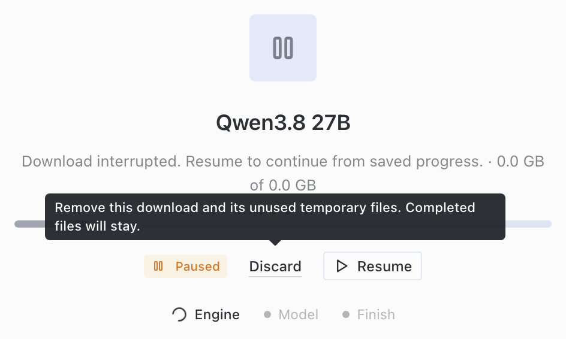

# Engine download recovery validation

Source: `a9e2d17785c5618f88ebf049fa7339197521a3e1`. macOS 26.4, arm64.

## Shared fix

Mirror failures retain all attempted URLs and whether a source can recover. The package installer keeps its existing `InstallError`. The worker preserves its typed download cause. Model and engine jobs read the same cause. Pause also carries source URLs, so Discard can clean up both paths.

The follow-up changes four existing production files, with 54 net lines added. It replaces the mocked runtime-outage cases with real installer/worker checks.

## Automated results

- 266 Python tests passed across 27 files.
- 53 desktop tests passed across six files.
- Five built Electron tests passed, including Resume and Discard after app/backend restarts.
- 12 repository checks passed; code health reported zero blocking or advisory findings.
- Desktop source build and TypeScript checks passed.

Before the corresponding fixes, four real-worker engine cases failed because Resume was missing. Four mirror cases lost their structured error type. Two further cases showed that Discard after manual Pause left the partial file behind. All now pass.

The new engine file has nine cases. It checks models already present and models still missing; bounded failures on both primary and mirror; Resume from the saved prefix; archive hash and installed contents; Discard; setup lock release; stale Resume; permanent access failures; and the original package name, remedy, and `InstallError` type.

The installer is forbidden to run in the parent process. A PID written during staging proves that the independent worker performs installation. The tests use local archive bytes, with fixture hardware selection and server/default callbacks.

## Reproduce

Use an isolated test interpreter and run:

```sh
scripts/run_tests.sh \
  tests/pm/test_downloader.py \
  tests/pm/test_downloader_integrity.py \
  tests/pm/test_download_recovery.py \
  tests/pm/test_download_checkpoint_policy.py \
  tests/pm/test_download_retry_limits.py \
  tests/pm/test_download_serial_fallback.py \
  tests/pm/test_download_mirrors.py \
  tests/pm/test_download_progress.py \
  tests/pm/test_download_state.py \
  tests/pm/test_network.py \
  tests/pm/test_network_retries.py \
  tests/pm/test_install_download_control.py \
  tests/hermes_cli/test_local_download_jobs.py \
  tests/hermes_cli/test_local_download_recovery.py \
  tests/hermes_cli/test_local_download_ownership.py \
  tests/hermes_cli/test_local_download_lifecycle.py \
  tests/hermes_cli/test_local_download_polling.py \
  tests/hermes_cli/test_local_quickstart_recovery.py \
  tests/hermes_cli/test_local_engine_download_recovery.py \
  tests/hermes_cli/test_model_flow_local.py \
  tests/hermes_cli/test_local_models_routes.py \
  tests/hermes_cli/test_local_runtime_pm.py \
  tests/pm/test_worker.py \
  tests/pm/test_worker_observers.py \
  tests/pm/test_worker_registry.py \
  tests/pm/test_worker_stdio.py \
  tests/pm/test_worker_receipts.py

npm run build --workspace apps/desktop
cd apps/desktop
HERMES_DESKTOP_PYTHON=/path/to/isolated/python npx playwright test \
  e2e/boot.spec.ts e2e/local-model-download-recovery.spec.ts --workers=1 --reporter=list
```

## Exploratory built UI check

The source-built app ran with an isolated home and backend. Its package manager used a separately staged PM interpreter. A local archive fixture stood in for the engine payload. Package installation, mirror handling, worker transport, job routes, and UI controls ran their actual implementations. Hardware/model selection and server/default side effects were fixture callbacks.

1. Keep the model and its companion files on disk. Start setup through **Set up for me**.
2. Interrupt the engine archive after 1 MiB. Click **Pause**, then **Resume**. Exhaust automatic recovery with HTTP 503 from the primary and mirror.
3. Check that the engine step stays paused with **Resume** and **Discard** available. The API reports exactly 1,048,576 saved bytes.
4. Restore the endpoint and click **Resume**. The request starts at byte 1,048,576 and completes byte 7,340,149. The installed file hash matches. Completed model files retain their contents and modification times.
5. Repeat setup with the engine absent. **Discard** after an outage removes this job's partials and releases setup ownership. Starting setup again succeeds. **Pause**, then **Discard** on the final backend also removes its partial files. Completed model files stay unchanged.

The crop below shows the engine step after the outage. It verifies that recovery controls remain available through the package worker. The small fixture rounds to 0.0 GB in the UI; API and disk checks verify exact byte counts. File deletion is verified separately from the image.



[Recorded UI results](ui-results.json).

These checks test recovery with fixture archives, not model inference. The full Python suite and this revision on Linux or Windows were not run. GitHub Actions needs maintainer approval.
